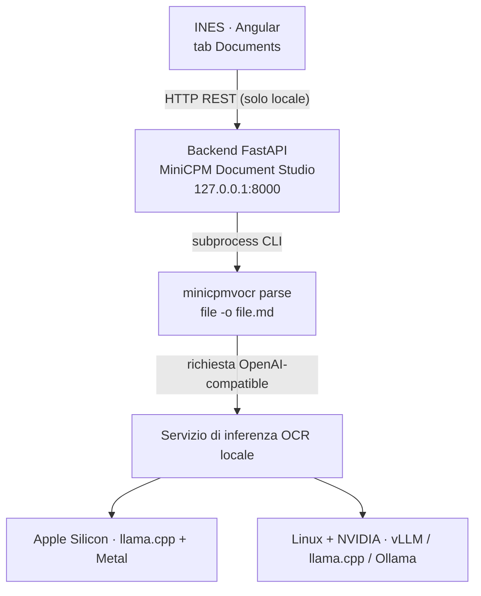
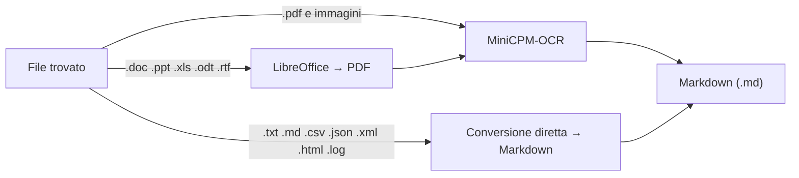

# 📄 Document Studio — MiniCPM Edge OCR

Il tab **Documents** integra in INES il flusso di **MiniCPM Document Studio**: conversione
locale di documenti in Markdown tramite OCR on-device (Edge AI). Nessun file lascia la
macchina.

---

## Architettura



---

## Il flusso passo-passo



1. INES invia `POST /api/jobs` con i percorsi assoluti e le opzioni.
2. Il backend **scansiona la cartella sorgente** (ricorsiva o solo primo livello) e
   individua i file supportati.
3. Per ogni file:

   | Categoria             | Estensioni                                             | Elaborazione                    |
   | --------------------- | ------------------------------------------------------ | ------------------------------- |
   | PDF & immagini        | `.pdf .png .jpg .jpeg .bmp .webp .tif .tiff .gif`      | OCR MiniCPM                     |
   | Office / OpenDocument | `.doc .docx .ppt .pptx .xls .xlsx .odt .ods .odp .rtf` | LibreOffice → PDF → OCR         |
   | Testo                 | `.txt .md .markdown .csv .json .xml .html .htm .log`   | conversione diretta in Markdown |

4. Per i file OCR viene eseguito `minicpmvocr parse <file> -o <file>.md`, che usa il
   **servizio di inferenza locale** (llama.cpp su Mac, vLLM su Linux).
5. Il backend aggiorna lo stato del job (file elaborati, pagine, errori); INES lo mostra
   in tempo reale con polling ogni secondo.
6. L'output viene scritto nella cartella di destinazione **preservando la struttura delle
   sottocartelle** (un `.md` per ogni file di input).
7. _(Opzionale)_ seconda passata `MINICPM_DIAGRAM_MERMAID=1`: i **diagrammi di flusso**
   presenti nelle immagini vengono riconosciuti e aggiunti come **Mermaid** accanto
   all'immagine.

---

## Prerequisiti

| Componente            | Requisito                             |
| --------------------- | ------------------------------------- |
| Python                | ≥ 3.10 (consigliato 3.12)             |
| Node.js / npm         | ≥ 22.12                               |
| LibreOffice           | solo per file Office/RTF              |
| MiniCPM-OCR SDK       | venv isolato `.minicpm-ocr`           |
| Servizio di inferenza | llama.cpp (Mac) o vLLM (Linux/NVIDIA) |
| Modelli GGUF          | ~2 GB (scaricati una tantum)          |

### Setup (una tantum)

```bash
./scripts/setup.sh backend    # venv FastAPI in backend/.venv
./scripts/setup.sh frontend   # npm install
./scripts/setup.sh sdk        # SDK MiniCPM-OCR in .minicpm-ocr
./scripts/setup.sh llm        # llama.cpp + modelli GGUF (~2 GB)
./scripts/setup.sh office     # LibreOffice
# oppure tutto insieme:
./scripts/setup.sh all
```

---

## Avvio

Servono **tre processi** (tre terminali):

```bash
# Terminale 1 — servizio di inferenza OCR (porta 18499)
./scripts/start_ocr.sh

# Terminale 2 — backend FastAPI (porta 8000)
./scripts/start_backend.sh

# Terminale 3 — frontend INES (porta 4200)
npm start
```

Verifica rapida: `./scripts/health.sh`

---

## Utilizzo nel tab Documents

1. Inserisci un **percorso assoluto** in _Cartella sorgente_.
2. Inserisci un **percorso assoluto** in _Cartella di destinazione_ (deve essere fuori
   dalla sorgente).
3. Scegli se **includere le sottocartelle** e se **sovrascrivere** i `.md` esistenti.
4. Clicca **Avvia conversione**.

Il pannello di monitoraggio mostra percentuale, file corrente, pagine, contatori
(successo/errore/saltati), feed dei file ed eventuali errori.

---

## API del backend

| Metodo | Endpoint         | Descrizione                                                    |
| ------ | ---------------- | -------------------------------------------------------------- |
| `GET`  | `/api/health`    | disponibilità CLI, backend, modello e LibreOffice              |
| `POST` | `/api/jobs`      | avvia un job: `{source_dir, output_dir, recursive, overwrite}` |
| `GET`  | `/api/jobs/{id}` | progresso, contatori ed errori per file                        |

---

## Note

- **CORS**: il backend accetta `http://localhost:4200` e `http://127.0.0.1:4200`;
  nessun proxy è necessario in sviluppo.
- L'**URL del backend** è modificabile direttamente nel tab (default
  `http://127.0.0.1:8000`) e viene salvato in `localStorage`.
- I file sorgente **non vengono mai modificati**.
- I documenti crittografati/protetti possono fallire la conversione Office.
- Rivedi sempre tabelle, diagrammi e numeri critici: l'OCR è best-effort.
- Non esporre l'API pubblicamente senza autenticazione e allowlist dei percorsi.

> **Modello**: OpenBMB MiniCPM-OCR · SDK `minicpmvocr` · tutto in Edge AI locale.
